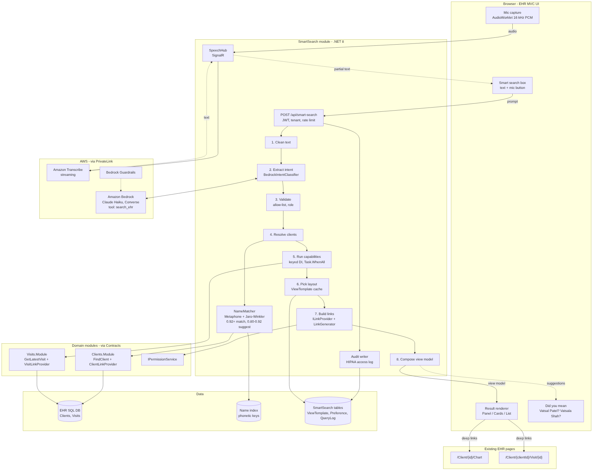

# EHR Smart Search: schema and views

These are the database schema, the view model contract, and interim Razor views for Smart Search.
The views are placeholders until the final design is ready. **When the design is final, you only change files under `Views/SmartSearch/` and `smart-search.css`.**

## Folder structure

```
Database/
  001_SmartSearch_Schema.sql      tables, indexes, name-matching procedures (schema "ss")
  002_SmartSearch_Seed.sql        intents, layout rules, view templates, nicknames
  003_SmartSearch_Statements.sql  adds the Statements layout (sentence per result with inline links)
src/
  SmartSearch.Contracts/
    SearchContracts.cs            ISearchCapability, ILinkProvider, ResultItemData, SearchContext
    ViewModels/SmartSearchViewModels.cs   THE contract the views read (SmartSearchResponse)
  SmartSearch.Application/Views/
    FieldMap.cs                   C# shape of ViewTemplate.FieldMapJson
    ViewModelComposer.cs          raw data + template + links -> SmartSearchResponse
  SmartSearch.Web/                (Razor Class Library)
    Controllers/SmartSearchController.cs  /smart-search/results, /click, /preview
    Controllers/SearchBoxOptions.cs
    Preview/PreviewData.cs        mock data for every UI state (Development only)
    Views/SmartSearch/
      _SearchBox.cshtml           search box + mic (drop into any page / main layout)
      _Results.cshtml             entry point, picks the layout
      Layouts/_Panel|_Cards|_List|_Statements|_Empty.cshtml
      Parts/_Header|_Fields|_Badges|_Links|_Statement|_DidYouMean|_FollowUps|_Paging|_Message|_Loading.cshtml
      Preview.cshtml              design preview page
    wwwroot/smart-search/
      smart-search.css            interim styles, design tokens at the top
      smart-search.js             search, layout toggle, did-you-mean, sorting, click tracking, mic
      pcm-worklet.js              mic audio -> 16 kHz PCM16 for Transcribe
design-preview/
  smart-search-states.html        static page showing all 9 UI states (open in a browser to review)
  smart-search-states.png         screenshot of the same page
docs/diagrams/
  EHR-Smart-Search.mmd            architecture diagram (Mermaid; Lucid: Insert > Diagram as code)
  EHR-Smart-Search.drawio         same diagram for draw.io / Lucid import
  EHR-Smart-Search.png            rendered diagram
```



## How the pieces connect

```
Bedrock intent ─► capability (module) ─► ResultItemData (raw, typed values)
                                             │
ss.ViewTemplate (FieldMapJson) ──────────────┤  ViewModelComposer
ILinkProvider (LinkGenerator + permission) ──┤
ss.LayoutRule / ss.UserPreference ───────────┘
                                             ▼
                                  SmartSearchResponse  ──►  _Results.cshtml ──► Panel / Cards / List
```

There are three layers, and each changes for a different reason:

| What changes | Where you change it |
|---|---|
| Look and feel (final design) | `Views/SmartSearch/**/*.cshtml`, `smart-search.css` |
| Which fields, labels, badges or links appear | `ss.ViewTemplate.FieldMapJson` (data, no deploy) |
| How many results pick which layout | `ss.LayoutRule` (data, per tenant if needed) |
| New data a design needs | Add a property to `SmartSearchViewModels.cs`, fill it in the composer |
| A new kind of search | New `ISearchCapability` + `ILinkProvider` in the owning module, plus seed rows |

## Statements layout (sentences with links inside them)

A list where each result is a sentence, for example:

> **[Vatsal Patel]** was seen for **[Psychiatric eval]** by **Dr. Mark Lewis** on 03-Nov-2026 10:30 AM *at Vadodara Clinic*

where the bracketed parts link to the client chart and the visit page.

The sentence is defined as data, in the `"statement"` property of `ss.ViewTemplate.FieldMapJson` (see `003_SmartSearch_Statements.sql`):

```
[{FirstName} {LastName}](ClientChart) was seen for [{VisitType}](VisitDetail) by **{ProviderName}** on {VisitDate:datetime} ~~at {Location}~~
```

| Syntax | Meaning |
|---|---|
| `{Field}`, `{Field:date}`, `{Field:datetime}` | a value from the capability's result row |
| `[text](LinkKey)` | a link to an existing page. The URL comes from the module's `ILinkProvider` by key, never from the template. If the user may not open that page, the text still shows, just without a link. |
| `**text**` | emphasis |
| `~~text~~` | muted, secondary detail |

How it flows:

1. `ViewModelComposer` parses the template into `ResultItem.Statement`, a list of `StatementSegment(Text, Style, Link?)`. It never produces raw HTML.
2. `Layouts/_Statements.cshtml` renders one `<li>` per result, and `Parts/_Statement.cshtml` renders the segments. Razor HTML-encodes every piece, so patient data can't inject markup.
3. Links carry `data-ss-link`, so clicks are tracked like any other result link. No JS changes are needed.

The layout appears as **Summary** in the layout toggle whenever a Statements template exists for that intent.
To make it the *default* layout for an intent, add rows to `ss.LayoutRule` (there's a commented example in `003`).
To change the wording, update the template row, which needs no deployment.

If you later want Bedrock to *write* the sentence (a free-form summary), keep the same segment model:
have the model return text plus entity references (for example `{"text":"...","entityType":"Visit","entityId":88213}`),
validate each reference against the IDs that were actually returned, and build the link with `ILinkProvider`.
Never accept URLs or HTML from the model.

## Rules for designers editing the views

You can change markup, classes and CSS freely. **Keep these attributes**, because `smart-search.js` depends on them:

| Attribute | Used for |
|---|---|
| `data-ss-root`, `data-ss-form`, `data-ss-input`, `data-ss-mic`, `data-ss-status`, `data-ss-output` | search box wiring |
| `template[data-ss-loading]`, `template[data-ss-error]` | loading and error states |
| `data-ss-results` + `data-ss-query-id` | lets re-runs reuse the stored intent (no extra LLM call) |
| `data-ss-layout="Cards"` | layout toggle |
| `data-ss-pick-client="1042"` | did-you-mean selection |
| `data-ss-followup="text"` | follow-up chips |
| `data-ss-page="2"` | paging |
| `data-ss-link="VisitDetail"` (also on links inside statements) + `data-ss-item` (with `data-entity-*`, `data-client-id`, `data-rank`) | click tracking |
| `data-ss-sortable` on `<th>`, `data-sort-value` on cells | client-side list sorting |

All values in the view model are already formatted (dates, names, labels), so views never format data.
Links are already permission-checked, so if a link is missing the user isn't allowed to open that page. Don't add fallback links in the views.

## Reviewing the design

- **Without running the app:** open `design-preview/smart-search-states.html` in a browser.
- **In the app (Development):** go to `/smart-search/preview`. It uses real Razor views with mock data. Type `vatsl` to see did-you-mean, and press the mic for a simulated transcription.

## Setup

1. **Database:** run `001_SmartSearch_Schema.sql`, then `002_SmartSearch_Seed.sql`, then `003_SmartSearch_Statements.sql`.
   - In `ss.usp_FindNameCandidates`, join your caseload / client-access view where it is marked `>>> ... <<<`.
     Without that join, suggestions could show clients the user cannot access.
   - Backfill `ss.ClientNameIndex` once, using `ss.usp_ClientNameIndex_Replace` with phonetic keys computed in .NET (Double Metaphone).
     After that, keep it in sync from the Clients module's create / update / merge events, and run a nightly re-sync.
2. **Razor Class Library:** reference `SmartSearch.Web` from the MVC host. Static files are served from `/_content/SmartSearch.Web/smart-search/`.
3. **Search box on a page:**
   ```cshtml
   <partial name="~/Views/SmartSearch/_SearchBox.cshtml" model="new SearchBoxOptions()" />
   <link rel="stylesheet" href="~/_content/SmartSearch.Web/smart-search/smart-search.css" />
   <script src="~/lib/microsoft/signalr/dist/browser/signalr.min.js"></script>  @* only needed for the mic *@
   <script src="~/_content/SmartSearch.Web/smart-search/smart-search.js"></script>
   ```
4. **DI registrations (in the host):** `ISmartSearchPipeline`, `IClickTracker`, `IViewTemplateStore` (cached), `ILayoutSelector`,
   and each module's keyed `ISearchCapability` and `ILinkProvider`.

## What is still to implement

These interfaces are defined, but they have no implementation in this package:

- `ISmartSearchPipeline`: the 8-stage pipeline (Bedrock intent → validate → NameMatcher → capability → composer). It writes `ss.QueryLog` and `ss.QueryResultEntity`.
  On re-runs (`queryId` + `layout` / `clientId` / `page`) it reloads `IntentJson` from `ss.QueryLog` and skips Bedrock.
- `IViewTemplateStore` (`GetAsync`, `ExistsAsync`) / `ILayoutSelector`: read `ss.ViewTemplate` / `ss.LayoutRule` / `ss.UserPreference`, cached with `IMemoryCache`.
- `IClickTracker`: inserts into `ss.QueryClick`.
- `SpeechHub` (SignalR, route `/hubs/speech`). The contract `smart-search.js` expects:
  - server method `StartTranscription(IAsyncEnumerable<string> audio)`. Each item is a base64 chunk of 16 kHz mono PCM16, about 100 ms of audio.
  - client events `transcript(string text, bool isFinal)` and `transcriptError(string message)`.
  - The hub forwards audio to Amazon Transcribe streaming (`AWSSDK.TranscribeStreaming`), in the `en-US` language with your custom vocabulary.
- Module capabilities and link providers (`Clients.Module`, `Visits.Module`).

## Assumptions to check

- The database is SQL Server 2019 or later. `TenantId` and `UserId` are `int`, and `ClientId` / `VisitId` are `bigint`. Adjust these types to match your tables.
- The deep-link routes in the preview (`/Client/{id}/Chart`, `/Client/{clientId}/Visit/{id}`) are placeholders. Real links come from `LinkGenerator` in each module, so they always match your existing routes.
- `QueryLog.RawTextEncrypted` assumes the app encrypts the prompt before storing it. You can switch that column to Always Encrypted if you prefer.
