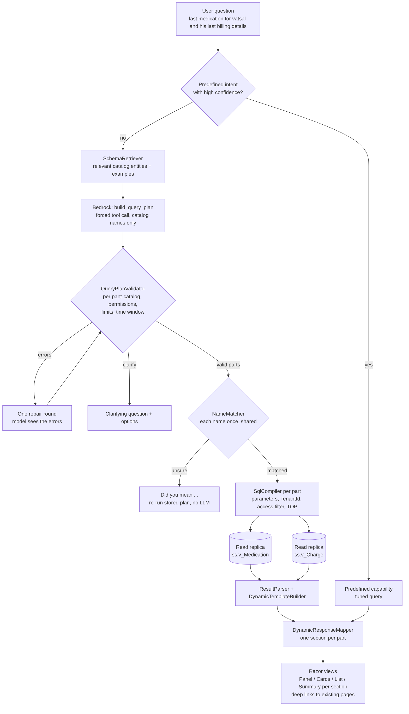

# Dynamic queries: questions no predefined intent covers

Users can type anything, for example:

> *"provide me details for last medication for vatsal and his last billing details"*

This question has **two parts in two domains**, and neither part exists as a predefined intent.
The dynamic path answers it without letting the AI write SQL.



## The core rule

**Bedrock never writes SQL and never sees data.** It fills in a small JSON *query plan*, using only
the entity and field names in the **semantic catalog**. .NET code then validates that plan and compiles it into
parameterized SQL that runs against curated views on a read-only replica.

| Concern | Where it is enforced |
|---|---|
| Only approved tables / columns | Catalog: the model sees `Visit.VisitDate`, never `dbo.ClientService.SvcDtTm` |
| Restricted data (SSN, note text) | `Sensitivity = 2`: left out of the prompt, rejected by the validator |
| Tenant isolation | Compiler always adds `TenantId = @__tenant`, and the model cannot remove it |
| Caseload / client access | Compiler adds the access predicate on the root table **and inside every EXISTS** |
| Domain permissions (billing...) | Validator checks each entity's `RequiredPermission`, part by part |
| SQL injection | Identifiers come only from the catalog and are checked and bracket-quoted. Every value is a parameter, and LIKE wildcards are escaped |
| 20 years of history | Default window on large tables (Visit 12 mo, Charge 24 mo) unless the user gives dates **or names a person**. There's a maximum lookback, `TOP` is always present, a 15 s timeout, and the query runs on a read replica under Resource Governor |
| Wrong guesses | Clarify instead of guessing. One repair round. The "Showing ..." line is rebuilt from the plan, not from the model's own words |

## Multi-part questions (several domains)

The plan is a **`SearchPlan` with one part per thing asked**:

```json
{"parts":[
  {"title":"Last medication","kind":"rows","entity":"Medication",
   "select":["Medication.DrugName","Medication.Strength","Medication.Frequency","Medication.Prescriber","Medication.StartDate","Medication.Status"],
   "where":{"field":"Client.FullName","op":"nameMatches","value":"vatsal"},
   "orderBy":[{"field":"Medication.StartDate","dir":"desc"}],"latestPerClient":true},
  {"title":"Last billing","kind":"rows","entity":"Charge",
   "select":["Charge.ServiceDate","Charge.ProcedureCode","Charge.BilledAmount","Charge.Payer","Charge.ClaimStatus","Charge.Balance"],
   "where":{"field":"Client.FullName","op":"nameMatches","value":"vatsal"},
   "orderBy":[{"field":"Charge.ServiceDate","dir":"desc"}],"latestPerClient":true}]}
```

- **Names are resolved once** and shared by every part. If the spelling is uncertain, the user gets a single "Did you mean" for the whole question.
- **Each part is validated on its own.** A user without `Billing.View` still gets the medication answer, and the billing section says "You don't have access to this information". The billing SQL never runs.
- **Parts run in parallel**, each on its own read-only connection with its own timeout. A part that times out says so, and the other parts still show.
- **The UI shows one section per part.** Each section picks its own layout (Panel / Cards / List / Summary), with links to the existing medication and billing pages.
- The **stored plan** (`ss.QueryLog.IntentJson`) is re-run for did-you-mean picks, layout changes and paging, **without calling Bedrock again**.

The same section model also works when the predefined-intent classifier returns several intents.

## Plan language (summary)

| Feature | Example |
|---|---|
| Filter | `{"field":"Visit.Status","op":"eq","value":"No show"}`. Ops: eq, neq, gt, gte, lt, lte, in, notIn, between, contains, startsWith, isNull, isNotNull, nameMatches |
| Combine | `{"and":[...]}`, `{"or":[...]}`, `{"not":{...}}` |
| Related data (one-to-many) | `{"exists":{"entity":"Diagnosis","where":{...}}}`, `notExists`, `minCount` for "more than N" |
| Related fields (many-to-one) | `Client.FirstName` directly on a Visit / Medication / Charge plan |
| Dates | `"2024-03-01"`, `"today"`, `{"relative":"-90d"}`, `{"startOf":"month","offset":-1}` |
| Latest per person | `"latestPerClient": true` |
| Counts / totals | `"kind":"aggregate"`, `groupBy`, `aggregates` (count, countDistinct, sum, avg, min, max) |
| Ambiguity | `{"clarify":{"question":"...","options":[...]}}` |

## Adding a new domain

Adding a domain such as lab results, authorizations or treatment plans needs no code change:

1. Build a curated view `ss.v_<Entity>` over the legacy tables. It must expose `TenantId`, a key and `ClientId`, and apply the soft-delete and merged-client rules once, inside the view. Index `(TenantId, ClientId, <main date>)`.
2. Add rows to `ss.SemEntity`, `ss.SemField` and `ss.SemRelation`, plus synonyms in `ss.SemSynonym`.
3. Add an `ILinkProvider` for the new entity so its rows link to the existing pages.
4. Add 2-3 verified examples to `ss.SemExample`.

## Keeping it accurate

- Every dynamic query is logged with its plan, SQL hash, tokens and timings. Review the rejected and clarify cases weekly.
- **Promote** common dynamic questions to `ss.SemExample`, and the very common ones to predefined intents (faster, and tuned by hand).
- `ss.SemExample` is also a regression suite. Run each stored plan through validator and compiler in CI (see `tests/SmartSearch.Tests`).

## Code map

| File | Role |
|---|---|
| `Database/004_SmartSearch_SemanticCatalog.sql` | Catalog tables, starter catalog (Client, Visit, Diagnosis, Appointment, Staff, **Medication**, **Charge**), examples, view template |
| `Dynamic/QueryPlan.cs` | `SearchPlan` / `QueryPlan` JSON language |
| `Dynamic/SemanticCatalog.cs` | Catalog model |
| `Dynamic/QueryPlanValidator.cs` | Safety gate, defaults, notes, per-part validation |
| `Dynamic/SqlCompiler.cs` | Plan → one parameterized T-SQL statement |
| `Dynamic/PlanPrompt.cs` | Catalog slice + rules + examples → system prompt and tool schema |
| `Dynamic/BedrockQueryPlanner.cs` | Anthropic Messages API on Bedrock (forced tool call, repair round) |
| `Dynamic/DynamicQueryService.cs` | Orchestration: plan → validate → names → parallel parts |
| `Dynamic/ResultParser.cs` | Rows → `ResultItemData`, plus the on-the-fly display template |
| `Dynamic/PlanDescriber.cs` | Plan → the "Showing ..." sentence |
| `Dynamic/DynamicResponseMapper.cs` | Result → `SmartSearchResponse` (sections) |
| `tests/SmartSearch.Tests` | 72 checks, run with `dotnet run --project tests/SmartSearch.Tests` |

## Still to implement (infrastructure)

- `IBedrockInvoker` with `AWSSDK.BedrockRuntime`. The 4-line implementation is in the interface comment.
- `ISemanticCatalogProvider` and `IPlanExampleStore`, which read the `ss.Sem*` tables (cached).
- `IReadOnlyConnectionFactory`: SqlClient to the readable secondary (`ApplicationIntent=ReadOnly`), with a login that can only `SELECT` on `ss.v_*`, placed in a Resource Governor workload group.
- `INameResolver`: wraps the existing NameMatcher.
- `ss.v_UserClientAccess` and the curated `ss.v_*` views over your real tables.
- A predefined-intent router: try the predefined intents first, and use the dynamic path when confidence is low or the intent is "Other".
